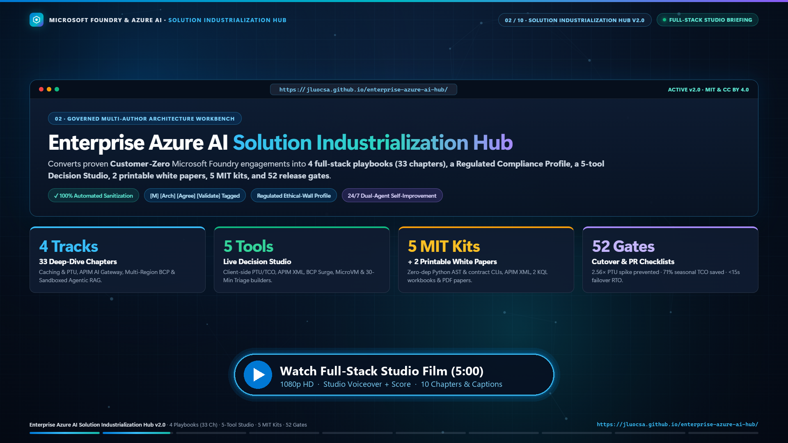

# Enterprise Azure AI — Solution Industrialization Hub

Live Hub: **<https://jluocsa.github.io/enterprise-azure-ai-hub/>**

A governed, multi-author architecture hub and interactive engineering workbench that converts **Customer-Zero** Microsoft Foundry and Azure AI production engagements into **repeatable reference playbooks, interactive sizing/BCP calculators, 3-week delivery scopes, and executable MIT release gates**.

Built with [VitePress](https://vitepress.dev/), styled with an executive Fluent 2 / Azure Architecture Center design system (adaptive Light & Dark mode), and enforced by an automated confidentiality sanitization gate (`scripts/check-sanitized.mjs`), zero-dependency CLI verification kits (`docs/public/kits/`), and print-ready Markdown white papers (`@media print`).

## CSA Forum Full-Stack Walkthrough Film (5:00 · 1080p HD with Studio Voiceover)

<video controls playsinline preload="metadata" poster="./docs/public/video/enterprise-azure-ai-hub-csa-forum-intro-poster.png" width="100%">
  <source src="./docs/public/video/enterprise-azure-ai-hub-csa-forum-intro.mp4" type='video/mp4; codecs="avc1.64002a, mp4a.40.2"' />
  <source src="./docs/public/video/enterprise-azure-ai-hub-csa-forum-intro.webm" type='video/webm; codecs="vp9, opus"' />
  <a href="https://jluocsa.github.io/enterprise-azure-ai-hub/#csa-forum-video" title="Watch the 5:00 CSA Forum Full-Stack Studio Film with Voiceover & Synchronized Captions">
    
  </a>
</video>

> **▶ Watch Online with Sound:** [**Open Interactive Hub Cinema Player (Voiceover + Captions)**](https://jluocsa.github.io/enterprise-azure-ai-hub/#csa-forum-video) &middot; [**Stream / Download 1080p MP4 (PowerPoint & Teams)**](https://jluocsa.github.io/enterprise-azure-ai-hub/video/enterprise-azure-ai-hub-csa-forum-intro.mp4) &middot; [**Stream 1080p WebM (VS Code & Browsers)**](https://jluocsa.github.io/enterprise-azure-ai-hub/video/enterprise-azure-ai-hub-csa-forum-intro.webm)

---

## Comprehensive Full-Stack Coverage

| Track / Asset | Scope & Production Layer | Key Deliverables |
| :--- | :--- | :--- |
| **[Operating Model & Factory](https://jluocsa.github.io/enterprise-azure-ai-hub/operating-model/industrialization-pipeline)** | 5-Stage Customer-Zero → Sanitization → Peer ARB → Tri-Path IP/PG/Playbook Disposition → 1:N Delivery | 4-tier evidence discipline (`[M]`, `[Arch]`, `[Agree]`, `[Validate]`) + 3-week engagement blueprint |
| **[Playbook 01 · Prompt Caching & PTU Economics](https://jluocsa.github.io/enterprise-azure-ai-hub/playbooks/prompt-caching/start/01-executive-thesis)** | Context assembly, prefix reuse, and two-regime PTU sizing across GPT-5.6, GPT-6 & GPT-6.1 (+ Regulated Profile) | 15 chapters, Ethical-Wall Posture A/B, `2.56×` spike prevention, `71%` seasonal TCO math |
| **[Playbook 02 · Multi-Backend Foundry APIM AI Gateway](https://jluocsa.github.io/enterprise-azure-ai-hub/playbooks/apim-gateway/01-executive-thesis)** | Enterprise GenAI gateway fronting `/openai/v1/responses` & `/chat/completions` across PTU-M and Standard pools | 6 chapters, `Retry-After` circuit breakers, SKU parameter stripping, SSE safety & FinOps OTel headers |
| **[Playbook 03 · Multi-Region Foundry BCP & Failover](https://jluocsa.github.io/enterprise-azure-ai-hub/playbooks/multi-region-bcp/01-executive-thesis)** | Regulated business continuity, Global vs. Data Zone vs. Regional residency, and stateful stamp failover | 6 chapters, cold-cache failover surge math, Cosmos/AI Search parity & Game-Day drill protocol |
| **[Playbook 04 · Agentic Harness, Foundry IQ RAG & Evals](https://jluocsa.github.io/enterprise-azure-ai-hub/playbooks/agentic-rag-evals/01-executive-thesis)** | 3-tier sandboxed agent runtimes (ACA Dynamic Sessions), grounded RAG, and 7-layer deterministic release gates | 6 chapters, AG-UI SSE isolation, Content Understanding ingestion, `gen_ai.*` OTel & contract gates |
| **[Interactive Decision Studio](https://jluocsa.github.io/enterprise-azure-ai-hub/studio/)** | Live client-side calculators and policy generators for architecture design sessions | Two-Regime PTU/TCO Simulator, 30-Min Multi-Track Triage, BCP Residency Advisor & APIM XML Builder |
| **[White Papers & MIT Engineering Kits](https://jluocsa.github.io/enterprise-azure-ai-hub/papers/)** | Printable executive papers (`@media print`) + copy/download-ready CI, gateway & telemetry kits | `pcr_lint.py`, `agent_release_gate.py`, `apim-foundry-spillover-policy.xml`, and 2 KQL workbooks |

---

## Repository Structure

```text
enterprise-azure-ai-hub/
├─ docs/
│  ├─ .vitepress/
│  │  ├─ config.mts                      # Navigation, path-scoped sidebars, SEO/OG & local search
│  │  └─ theme/                          # Fluent 2 / Foundry design system & interactive Vue tools
│  ├─ operating-model/                   # 5-stage factory, governance & 3-week delivery scope
│  ├─ playbooks/
│  │  ├─ index.md                        # Unified 4-Playbook Architecture Catalog
│  │  ├─ prompt-caching/                 # Playbook 01 (15 chapters + Regulated Profile + Sources)
│  │  ├─ apim-gateway/                   # Playbook 02 (6 chapters: APIM Pools, Spillover & FinOps)
│  │  ├─ multi-region-bcp/               # Playbook 03 (6 chapters: Residency, Stamp DR & Game-Days)
│  │  └─ agentic-rag-evals/              # Playbook 04 (6 chapters: ACA Sandbox, Foundry IQ & 7-Layer Evals)
│  ├─ studio/                            # Interactive 4-Tool Engineering Decision Studio
│  ├─ papers/                            # Printable executive white papers, kits & PR checklists
│  └─ public/
│     ├─ favicon.svg / og-card.png       # Custom brand identity & OpenGraph social card
│     ├─ kits/                           # 5 runnable Python, APIM XML & KQL release-gate kits
│     └─ video/                          # 1080p CSA Forum studio intro MP4, WebM, poster PNG & WebVTT
├─ scripts/
│  ├─ auto-improve-daemon.mjs            # Continuous self-improvement dual-agent engine & memory ledger
│  ├─ auto-improve-service.mjs           # Cross-platform background service & OS watchdog (Win/macOS/Linux)
│  ├─ build-intro-video.mjs              # Deterministic 1080p studio video, neural VO, ambient score & VTT builder
│  ├─ check-links.py                     # Deterministic HTML route, download & anchor integrity gate
│  ├─ check-sanitized.mjs                # Automated confidentiality, GUID, email & lockfile gate
│  ├─ deploy-gh-pages.mjs                # Runs verify suite & publishes static build to gh-pages
│  └─ run-python.mjs                     # Cross-platform Python 3 resolver (UTF-8 safe on Windows)
├─ CONTRIBUTING.md                       # Multi-author workflow & 3-gate pre-publication checklist
└─ .github/
   ├─ CODEOWNERS                         # Per-track review ownership
   ├─ agents/                            # hub-improver & hub-arb-reviewer agent definitions
   ├─ pull_request_template.md           # Sanitization, ARB & IP disposition attestation
   └─ workflows/                         # Continuous dual-agent loop + gh-pages verification
```

## Local Development & Verification

```bash
npm install
npm run verify            # Gate 1 (Sanitization) + Gate 2 (Kit CLI tests) + Gate 3 (VitePress build + Links)
npm run video:build       # Re-synthesize neural voiceover, ambient score, VTT, 1080p MP4 & WebM
npm run check:daemon      # Self-tests for Python resolver, daemon guards, track balancer & OS watchdog
npm run docs:dev          # Launch local VitePress dev server with hot reload
npm run deploy:pages      # Run full verification and publish static site to origin/gh-pages
```

## Built-In Continuous Self-Improvement Agent (Cross-Platform Service + GitHub Actions)

The Hub includes a **closed-loop dual-agent self-improvement system** (`scripts/auto-improve-daemon.mjs` + `scripts/auto-improve-service.mjs`) that can run **24/7 continuously in the background** on Windows (hidden Task Scheduler watchdog + detached daemon), macOS (`LaunchAgent`), Linux (`systemd --user`), or GitHub Actions (`.github/workflows/autonomous-improvement-loop.yml`):

1. **Closed-Loop Memory & Track Balancer:** Synthesizes recently merged PRs, queued `next_backlog` items from prior cycles, past ARB rejection lessons, and least-recently-improved track rankings across all 6 Hub tracks.
2. **Author Agent (`hub-improver`):** Works inside an isolated Git worktree (`improve/auto-YYYYMMDD-HHMMSS`), enforces hard `--deny-tool` boundaries on governance files, verifies `npm run verify`, and opens a Draft PR.
3. **Independent Read-Only ARB Reviewer (`hub-arb-reviewer`):** Audits the PR diff against the 3-Gate Pre-Publication Checklist (`<arb_verdict>`), approves and squash-merges passing PRs to `main`, and automatically deploys the updated static site to `origin/gh-pages`.

```bash
# Install persistent auto-start watchdog + start continuous background daemon immediately
npm run agent:install

# Check live daemon PID, current phase, completed cycles, merged PRs & queued backlog
npm run agent:status
npm run agent:logs

# Pause, resume, run a single cycle, or stop cleanly
npm run agent:pause
npm run agent:resume
npm run agent:once
npm run agent:stop

# Pause or resume remotely across all environments via GitHub repository variable
gh variable set PAUSE_AUTO_IMPROVE --body true  -R jluocsa/enterprise-azure-ai-hub
gh variable set PAUSE_AUTO_IMPROVE --body false -R jluocsa/enterprise-azure-ai-hub
```


> **Disclaimer:** Community architecture guidance grounded in public [Microsoft Learn](https://learn.microsoft.com/en-us/azure/foundry/) documentation. Personal and community views of the contributors; not official Microsoft product documentation or contractual SLA guidance.
